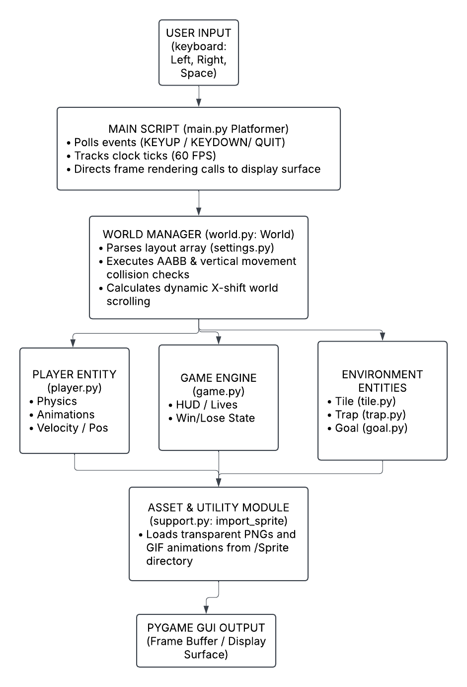

# Sam's Feline Adventures

**Sam's Feline Adventures** is a 2D retro arcade-style platformer built in Python using Pygame. Play as **Sam the Cat**—a purple animatronic feline with blue accents, glowing red eyes, and an orange bowtie—as you leap across platforms, dodge animated mechanical hazards, traverse 3 progressively challenging levels, and reach the cupcake goal.

---

## Table of Contents
1. [Dependencies & External Libraries](#dependencies--external-libraries)
2. [Setup & Configuration](#setup--configuration)
3. [How to Run the Application](#how-to-run-the-application)
4. [Basic Instructions & Controls](#basic-instructions--controls)
5. [Technical Design](#technical-design)

---

## Dependencies & External Libraries

To run the game, ensure you have **Python 3.10+** installed along with the following external libraries:

* **`pygame`**: Core game engine used for window creation, 60 FPS game loop clock management, sprite rendering, rectangle/mask collision detection, font rendering, and low-latency audio mixing (`pygame.mixer`).
* **`Pillow` (`PIL`)**: Used by the sprite loader (`support.py`) to extract and convert multi-frame animated `.gif` hazards (`harsh.gif`) into Pygame surfaces with alpha transparency.

---

## Setup & Configuration

1. **Clone or Extract the Project:**
   Place the `Sam's Feline Adventures` project folder on your local machine.

2. **Verify Asset Directories:**
   Ensure the `Sprites/` and `Sound Effects/` directories remain in the same root directory as `main.py` so relative asset paths resolve properly:
   * `Sprites/player/` (`idle/`, `walk/`, `jump/`, `fall/`, `lose/`, `win/`)
   * `Sprites/terrain/` (`bg.png`, `ground.png`)
   * `Sprites/trap/` (`harsh.gif`)
   * `Sprites/goal/` (`cupcakegoal.png`)
   * `Sprites/life/` (`life.png`)
   * `Sound Effects/` (background music and SFX `.wav` files)

3. **Install Required Packages:**
   Open a terminal in the project root directory and run:
   ```bash
   pip install pygame pillow
   ```

4. *(Optional)* **Adjust Game Constants:**
   You can customize screen dimensions, tile size, level grids (`level_1`, `level_2`, `level_3`), gravity, and jump velocity directly in `settings.py`.

---

## How to Run the Application

1. Open your terminal (or VS Code integrated terminal) inside the `Sam's Feline Adventures/` root directory.
2. Execute the main entry point:
   ```bash
   python main.py
   ```
3. *(Optional)* To run the automated unit test suite via Python's built-in `unittest` module:
   ```bash
   python -m unittest discover -s tests
   ```

---

## Basic Instructions & Controls

### Controls
| Key | Action |
| :--- | :--- |
| **Left Arrow (`←`)** | Move Sam left |
| **Right Arrow (`→`)** | Move Sam right |
| **Up Arrow (`↑`)** | Jump (tap for a short hop, hold for a full Mario-style high jump; works while moving) |
| **Enter (`↵`)** | Retry the current level upon Game Over, advance to the next level upon clearing a stage, or restart from Level 1 after beating all 3 levels |

### Gameplay Rules
* **Objective:** Navigate through **3 progressively harder levels** and touch the **Cupcake Goal** at the end of each stage.
* **Lives & Traps:** Sam starts each level with **5 lives** (displayed in the top-left HUD). Touching an animated trap knocks Sam back, deducts 1 life, triggers a brief invulnerability cooldown, and plays a damage sound effect.
* **Game Over & Replay:** Falling off the bottom of the screen or losing all 5 lives stops the background music and triggers Game Over. Press **Enter** to immediately reset and retry the exact level you were on.

---

## Technical Design

The project follows a modular, object-oriented architecture that separates rendering, physics, level management, audio, and testing into dedicated modules:

```text
Sam's Feline Adventures/
│
├── main.py             # Central 60 FPS game loop, keyboard input set tracking, and state transitions
├── settings.py         # Global constants (screen dimensions, tile size, Mario jump physics, and 3 level maps)
├── world.py            # Level layout parser, camera scrolling, AABB collision resolution, trap cooldowns, and level resets
├── player.py           # Sam's sprite state machine, horizontal movement, variable-height jump logic, and animation handler
├── tile.py             # Static terrain and platform block sprites
├── trap.py             # Animated hazard sprites with pixel-mask collision boundaries
├── goal.py             # Level-completion cupcake goal sprite
├── game.py             # HUD rendering (life counter & level indicator) and win/lose screen state overlays
├── sound_manager.py    # Low-latency audio wrapper managing looping background music and game SFX
├── support.py          # Asset utility for loading image directories and slicing multi-frame GIFs via Pillow
├── Sprites/            # Visual assets organized by entity and animation state
├── Sound Effects/      # Audio files for music, jumping, damage, savepoints, and game over
└── tests/              # Headless unit tests (`test_player.py`, `test_world.py`) verifying physics and world resets
```

### Component Interaction Workflow
1. **Initialization (`main.py` & `sound_manager.py`):** `main.py` pre-initializes `pygame.mixer` with a low-latency buffer (`256`), creates the display window (`1000x500`), starts the looping arcade soundtrack via `SoundManager`, and instantiates `World` on Level 1 (`level_index=0`).
2. **Input & Physics Loop (`main.py` $\rightarrow$ `player.py`):** Active directional and jump keys are stored in a `keys_pressed` set so Sam can jump and move horizontally at the same time. Releasing the Up Arrow mid-ascent calls `Player.jump_cut()`, multiplying upward velocity to create responsive variable jump heights.
3. **World Simulation & Collisions (`world.py`):** Every frame at $60\text{ FPS}$, `World.update()` shifts sprites horizontally when Sam approaches the screen edges (`_scroll_x`), applies gravity (`GRAVITY = 0.8`), resolves horizontal and vertical tile collisions independently against `Tile` groups, checks `Trap` collisions with a 30-frame cooldown, and delegates HUD/win-lose checks to `Game`.
4. **State & Level Progression (`game.py` & `world.py`):** Reaching the `Goal` sprite advances `current_level_index` via `World.advance_level()`, playing the savepoint chime and loading the next stage. Losing all lives or falling out of bounds stops the music, plays the Game Over sound, and allows instant per-level resets via `World.reset_world()`.### Architecture Diagram


